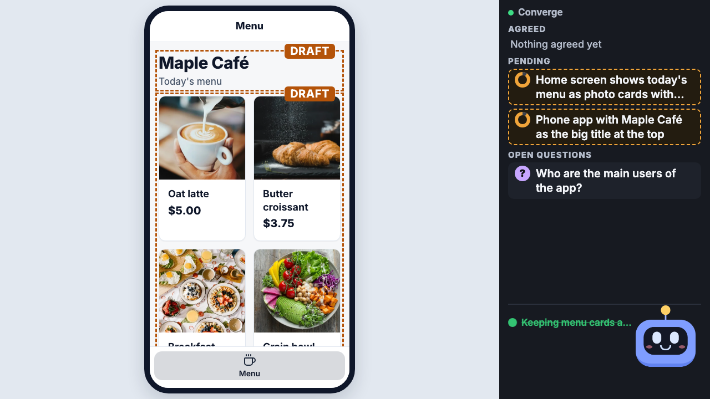
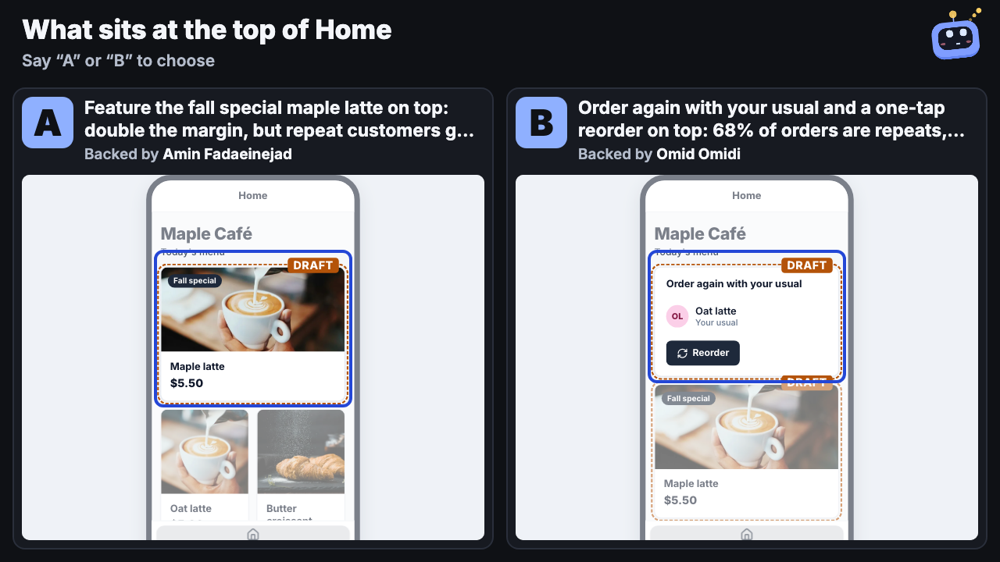
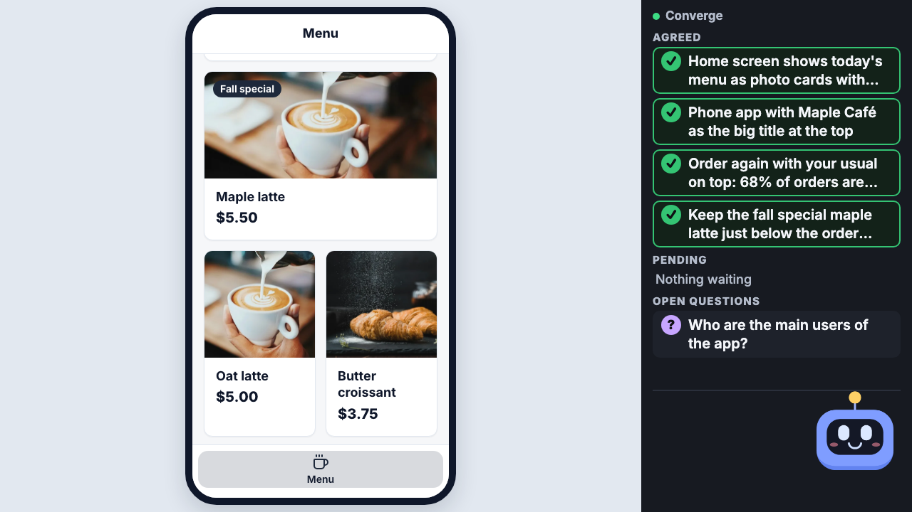
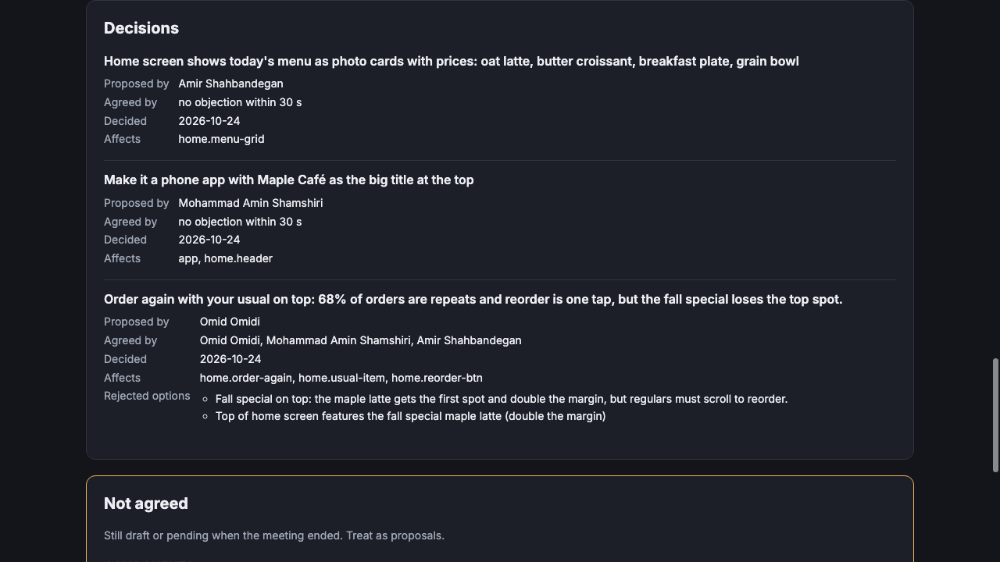

# Demo script: Maple Café

The script for the Build North demo video (at most 2 minutes). Four people build a café's mobile ordering app in a
Google Meet while Builder listens. The point of the video is one moment: two people disagree, Builder shows both
versions side by side, the room picks one out loud, and the record says who decided what.

The lines below are the ones we replayed into the engine with the live models (`apps/engine/test/fixtures/sessions/maple-cafe.json`,
sent the way Recall's low-latency transcript sends them: lowercase, no punctuation). They passed three runs in a row
on 2026-10-24. Say them as written; small wording changes are fine, but keep the pick lines exactly.

## Who plays whom

| Meet name | Role | In one line |
|---|---|---|
| Amir Shahbandegan | Product lead | Starts the build and closes the decision |
| Mohammad Amin Shamshiri | Designer | Makes it a phone app; breaks the tie for B |
| Amin Fadaeinejad | Marketing | Wants the fall special at the top |
| Omid Omidi | Operations | Wants "Order again" at the top |

## The lines

Times are from the start of the call, with Builder already in it. Leave a short beat after every line and speak one
at a time.

| # | When | Who | Say | On screen after it |
|---|---|---|---|---|
| | 0:00 | Builder | *(its opening, about 5 s: who it is, "what's the app?")* | Builder's face, empty stage |
| 1 | 0:06 | Amir | Hey Builder, we're designing the mobile ordering app for Maple Café, our coffee chain. | Builder answers with one short question; let it finish |
| 2 | 0:11 | Amir | The home screen shows today's menu as photo cards with prices: oat latte, butter croissant, breakfast plate and a grain bowl. | A phone app with four photo cards and prices, dashed "draft" outlines |
| 3 | 0:18 | Mohammad Amin | Make it a phone app, with Maple Café as the big title at the top. | "Maple Café" as the page title |
| 4 | 0:24 | Omid | Looks great. I'm happy with the menu and the phone layout. | The outlines turn solid; the menu and the header show under **Agreed** |
| 5 | 0:32 | Amin | The top of the home screen should sell our fall special, the maple latte. It has double the margin of anything else. | The fall special drawn at the top, as a draft |
| 6 | 0:39 | Omid | I disagree. Sixty eight percent of our orders are repeat orders. The top should be Order again, with your usual and a one tap reorder button. | After 10–20 s: the screen splits into **A** (fall special on top, backed by Amin) and **B** (Order again on top, backed by Omid) |
| | | everyone | *Wait for both options to be on screen. Say nothing in the meantime.* | |
| 7 | ~1:00 | Mohammad Amin | Looking at both, I'd go with B. Regulars pay the bills, and one tap is faster in the morning rush. | B grows into the app, A folds away. Builder says **"So: B. Everyone OK?"** |
| 8 | ~1:06 | Amir | Agreed, B it is. But keep the fall special just below it. | Amir is added to who agreed on B; the special settles just below "Order again" |
| 9 | ~1:13 | Amin | Fine by me, as long as the special stays above the menu. | The follow-up shows under Agreed (or Pending, turning Agreed 30 s later) |
| 10 | ~1:24 | Amir | That's the plan. Thanks Builder. | Everything solid |

### What it should look like

| After line 4 | After line 6 | After line 9 | The handoff page |
|---|---|---|---|
|  |  |  |  |

## Delivery notes

- **Say the pick on its own.** "I'd go with B" is what resolves the choice, so say "B" clearly as its own word.
  Don't add "maybe", "if", "not", "then", "instead" or a second option to that sentence, or Builder (correctly) won't
  treat it as a pick. The model still may, but slower.
- **Wait for both options before line 7.** If B is said before the split screen is up, nothing is there to pick.
- **One person at a time.** Overlapping speech gets merged or cut by the transcriber.
- **If Builder misses a line**, the speaker repeats it once, word for word. Don't explain or rephrase.
- **Don't chat between lines.** Every sentence about the app becomes a proposal on screen. Side talk (in any
  language) shows up as noise in the transcript.
- **Builder speaks three times:** its opening, a short answer to line 1, and "So: B. Everyone OK?". Line 9 is the
  answer to that last one.

## Before recording

1. Merge the `engine/demo-readiness` PRs into `main` in the listed order (main auto-deploys the engine on Render)
   and wait for the deploy to finish.
2. Check that the engine's OpenRouter key has credit. One run of this script costs about $0.10–0.15; a credit
   balance near zero makes every build call fail with 402.
3. Check `TTS_VOICE` is set on the engine service, so Builder talks instead of writing in the chat.
4. Start a session from the web app (or the Expo app on a phone, which is worth a second in the video) with the
   Meet link, and admit the bot.
5. All four join with the Meet names above (the names on the handoff page come from them).
6. After the call, open the handoff link from the session page for the last shot.

## The 2-minute cut

| Time | Show | Audio |
|---|---|---|
| 0:00–0:08 | Title card: "Builder — your meeting builds the prototype" | Voiceover: one line on the problem: meetings decide things nobody can see until someone builds it |
| 0:08–0:32 | Lines 1–4: the app appears and turns solid | The meeting |
| 0:32–0:50 | Lines 5–6, cut the wait, land on the split screen | The meeting |
| 0:50–1:10 | Lines 7–8: B wins, "So: B. Everyone OK?" | The meeting |
| 1:10–1:35 | The handoff page: decisions, who proposed, who agreed, the rejected option | Voiceover: only things people actually said count as agreement; the model never marks anything agreed by itself |
| 1:35–1:55 | Quick flashes: the web app's session list, the Expo app, the session history | Voiceover: Recall for the meeting, Claude for listening and building, SurrealDB for the record, Clerk for accounts, Expo for mobile |
| 1:55–2:00 | Closing card with the repo link | — |
